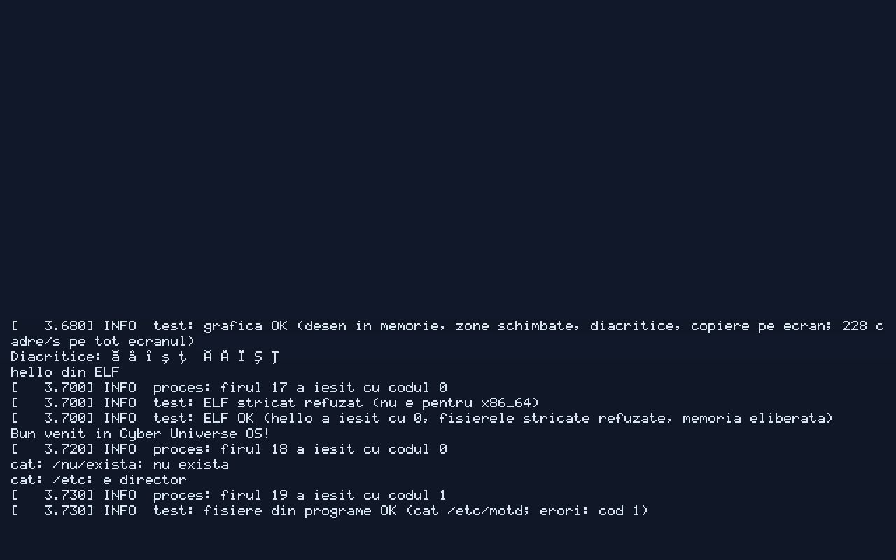

# Cyber Universe OS

[](https://github.com/Adriancu91/cyber-universe/actions/workflows/ci.yml)



Sistem de operare propriu, construit de la zero: **minim, modular, rapid pe hardware slab**.

- Nucleu propriu (Rust, x86_64, UEFI), dezvoltat întâi în emulatorul QEMU, apoi pe hardware real.
- Doar ce aduce plus: drivere, funcții utile, aplicații minime necesare.
- Sistem de module: aplicațiile proprii (suita office, Kronos etc.) se adaugă și se scot ca module.
- Compatibilitate construită treptat, funcție cu funcție, prin metoda clean-room.
- Țintă pe termen lung: dezvoltarea OS-ului din interiorul lui (auto-găzduire).

## Documente principale

| Fișier | Rol |
|---|---|
| `CLAUDE.md` | Regulile pe care Claude Code le citește la fiecare sesiune |
| `docs/ROADMAP.md` | Direcția: fazele proiectului și criteriile de terminare |
| `docs/TASKS.md` | Coada de sarcini în cascadă (următoarea sarcină = prima nebifată) |
| `docs/plans/` | Planul detaliat al fiecărei sarcini (`P0-01.md`, …) |
| `docs/research/` | Studii, versiuni verificate și prototipul de pornire |
| `docs/STATE.md` | Unde s-a oprit ultima sesiune și ce urmează |
| `docs/BLOCKERS.md` | Probleme pe care Claude nu le-a putut rezolva singur |
| `docs/DECISIONS.md` | Deciziile tehnice luate și de ce |
| `docs/CLEAN_ROOM.md` | Regulile legale de studiu și reconstrucție |
| `docs/SCHEDULE.md` | Cum rulează munca automată și cum se reia după blocaje |
| `docs/ARCHITECTURE.md` | Structura sistemului și a folderelor |
| `PREGATIRE.md` | Lista pentru Adrian: ce trebuie pregătit înainte de start |

## Structura folderelor

```
boot/      configurare bootloader (Limine) și imagine de pornire
kernel/    nucleul Cyber Universe (Rust)
modules/   module de sistem (drivere, servicii)
apps/      aplicații proprii (office, Kronos etc.), adăugate ca module
tools/     scripturi de build, rulare QEMU, testare
tests/     teste automate (rulează nucleul în QEMU și verifică ieșirea)
docs/      planul, starea și deciziile proiectului
```

## Licență

Codul propriu: MIT (vezi `docs/DECISIONS.md`, D-005).
